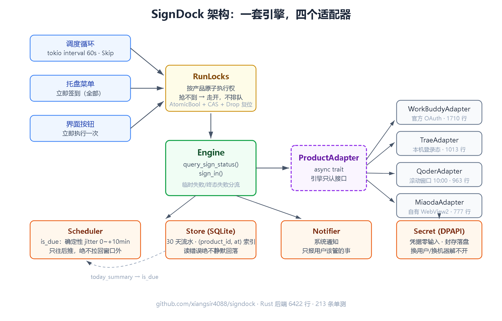
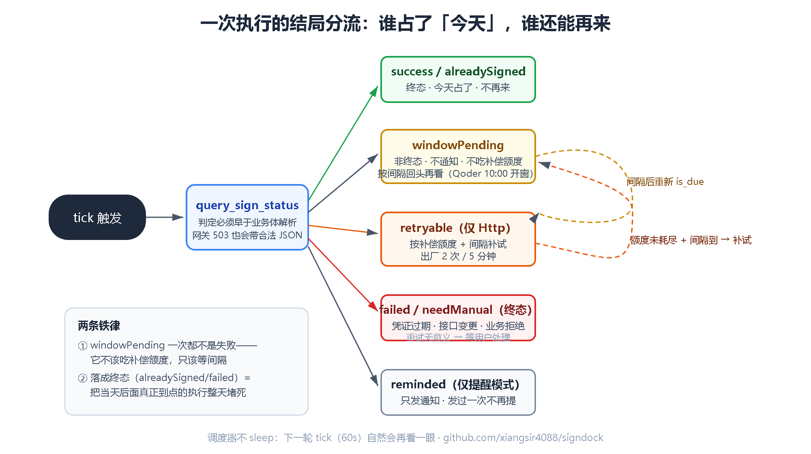

# Tauri 2 + Rust 写一个无人值守的 Windows 托盘工具：4 个 AI 产品（workbuddy+trae+qoder+秒哒）自动签到，我把这些坑趟平了

> 项目地址：`https://github.com/xiangsir4088/signdock` ｜ License：MIT ｜ 绿色版 4.6MB ｜ Rust 后端 6422 行 / 213 条单测

> **【开栏引言】** 这是「AI 结对实录」专栏的第一篇。这个专栏只写一件事：**我和 AI 结对把一个真实项目从零做到发布，全程记录 AI 写了什么、在哪翻的车、我怎么验收**。不吹 AI 万能，也不贩卖焦虑，只留过程实录。专栏计划四组项目：SignDock（本篇，Windows 托盘工具）、QuantMind AI（A股量化系统）、AI for SRE（云服务运维平台）、以及【第四个项目待补】。每篇独立成文，方法论沉淀在本篇的「AI 协作实录」一节，后续文章不再重复。

作为每天要用好几家 AI 产品（WorkBuddy、Trae、Qoder、秒哒）的人，我最烦的一件事就是每天记着去领免费额度。忘一次少一天，一个月下来少几百积分。

于是有了 **SignDock**：一个 Tauri 2 + Rust 的 Windows 托盘常驻程序，按配置时间自动领这几家的每日免费额度，领完系统通知，历史存本地 SQLite。全程不复制粘贴任何 token，免安装，解压即用。核心开发 7 天（9/22 设计 → 9/28 发布），之后 18 天迭代了两个修复版本。

这篇文章不讲工具怎么用，讲三件事：**① 几处机制级的设计决定（并发、幂等、风控）；② 我和 AI 怎么分工、AI 在哪翻的车、我怎么验收；③ 踩坑速查表**。

## 一、为什么选 Tauri 2 + Rust 而不是 Electron

SignDock 是托盘常驻工具，7×24 挂在后台，体积和内存是硬指标：

| 维度 | Electron | Tauri 2 + Rust（实测） |
|---|---|---|
| 绿色版体积 | 80-150MB（带 Chromium） | **4.6MB**（用系统 WebView2） |
| 常驻内存 | 200MB+ | ~80MB |
| 发布物 | 单 exe 几百 MB | exe 13MB + 前端资源 |

Rust 的 tokio 调度器天然适合「每 60 秒 tick、按产品独立并发」的调度循环，比 Node 事件循环更可控——这是后文的关键前提。

前端我选了 **vanilla TypeScript（无框架）**：整个 UI 就一个 `main.ts` + 一个 `styles.css`，Tauri IPC 调 Rust 命令。规模到这就够了，引框架纯属给构建链找事。

## 二、整体架构：4 个产品共用一套引擎



核心抽象是把「怎么领」收进 trait，引擎只认接口：

```rust
#[async_trait]
pub trait ProductAdapter: Send + Sync {
    fn id(&self) -> String;
    /// Err = 网络/临时错误或凭证问题（可重试性由上层按变体判断）
    async fn query_sign_status(&self) -> Result<SignStatus, AdapterError>;
    /// Ok = 签到系统明确应答
    async fn sign_in(&self) -> Result<SignOutcome, AdapterError>;
}
```

四个适配器各自实现（WorkBuddy 1710 行、Trae 1013 行、Qoder 963 行、秒哒 777 行），引擎零改动。加第 5 款产品 = 新增一个文件。

调度循环每 60 秒 tick 一次，这里有一个必须做对的小设置：

```rust
let mut ticker = tokio::time::interval(Duration::from_secs(60));
ticker.set_missed_tick_behavior(MissedTickBehavior::Skip);
```

**为什么 `Skip` 必须设**：默认行为下，某次 tick 里若一个产品的请求挂了 5 分钟，ticker 会把错过的 tick 疯狂补发，后面所有产品被一起拖住。`Skip` 保证「一次挂起的请求只影响它自己」。无人值守工具的第一底线：单个故障不许扩散。

## 三、按产品的「执行权」：为什么用原子标记而不是 Mutex

三路触发会同时打向同一个产品：调度循环（60s tick）、托盘「立即签到（全部）」、界面「立即执行一次」。不互斥 = 重复签到、重复通知、数据竞态。

```rust
pub struct RunLocks {
    slots: Vec<(&'static str, Arc<AtomicBool>)>,
}

impl RunLocks {
    /// None = 该产品正在执行，调用方本轮直接跳过（绝不排队）
    pub fn acquire(&self, id: &str) -> Option<RunGuard> {
        let flag = /* 按产品取标记 */;
        flag.compare_exchange(false, true, Ordering::AcqRel, Ordering::Acquire)
            .ok().map(|_| RunGuard { flag })
    }
}

impl Drop for RunGuard {
    fn drop(&mut self) { self.flag.store(false, Ordering::Release); }
}
```

**为什么不用 `Mutex`**：`Mutex::lock()` 是排队语义——一旦 `run_once` 里某产品的 HTTP 请求挂死，整个调度循环堵在它后面。原子标记 + `acquire` 返回 `None` 的语义是「**抢不到就走开，下一轮 60s 再看**，绝不阻塞别的产品」。宁可这个产品这轮少跑，不让整个托盘僵住。

`Drop` 自动复位是第二层保险：哪怕 `run_once` 中途 panic，标记也释放。这也是 `Cargo.toml` 里特意**不用** `panic = "abort"` 的原因——abort 下 `Drop` 成了死代码，一个后台任务 panic 会让整个托盘当场消失，签到悄悄停摆。无人值守进程要保留 unwind：坏任务丢掉自己的结果，托盘继续活。

## 四、调度器：临时失败 vs 终态失败，必须分开

签到失败有几种完全不同的语义，混处理必出事故：

```rust
pub enum AdapterError {
    Http(String),           // 连接失败/超时/5xx/429 → 唯一可重试
    AuthExpired,            // 凭证过期 → 重试无意义
    SchemaChanged(String),  // 接口变了 → 重试无意义
    Business(String),       // 业务拒绝（额度/活动开关）→ 不重试
}
```

落库时**只有 `Http` 记为 `retryable`**，其余记终态 `failed`。判定还必须**早于**业务体解析——网关 503 也可能带回合法 JSON，先 parse 会把一次抖动读成「签到成功」。调度器据此决定是否补试：

```rust
if last_outcome != OUTCOME_RETRYABLE { return false; }
today.retry_failures <= cfg.retry_times
    && now >= last_at + cfg.retry_interval_min * 60
```

出厂默认 2 次补偿、间隔 5 分钟。凭证过期/接口变更重试只是反复打扰一个永远不会答的接口。

## 五、滚动窗口产品：「窗口未开」≠「今天处理完」

Qoder 的福利窗口**北京时间 10:00 才开**。9:30 手动点一次「立即执行」，看到的「已领取」其实是**上一轮**的。如果调度器把「看到已领」记为 `alreadySigned`，当天 10:05 的定时执行就因「今天已处理」被跳过——**用户永远领不到今天的额度**。

我引入独立状态 `WindowPending`：不通知（窗口没开不是用户该管的事）、落库为**非终态**、不消耗补偿额度，只按间隔回头再看一眼。配套回归测试：

```rust
#[test]
fn manual_run_before_window_keeps_scheduled_run_alive() {
    let s = summary(at(2026, 9, 22, 9, 30).timestamp(), OUTCOME_WINDOW_PENDING, 0);
    assert!(is_due(at(2026, 9, 22, 10, 20), "qoder", &cfg, &s),
        "窗口开了就得去领");
}
```

这个测试注释里写着它的来历：「10:00 前手点一次就把整天堵死」——是真实发生过才补的回归。

## 六、触发时间的确定性 jitter：只往后推，绝不拉回

四家都设 09:00，每天整点同时打四个接口，容易被风控识别为密集请求。加 0~+10 分钟 jitter：

```rust
pub fn jitter_minutes(product_id: &str, day: NaiveDate) -> i64 {
    let mut h = DefaultHasher::new();
    product_id.hash(&mut h);
    day.hash(&mut h);
    (h.finish() % 11) as i64
}
```

两个刻意的设计决定：

1. **确定性哈希，不是随机数**。同产品同一天 jitter 永远一样：你能准确算出它今天几点触发，单测也能精确断言。
2. **只取正向**。如果允许负向，Qoder 默认的 10:05 可能被拉到 10:00 之前——正好落在窗口开启前，命中的是上一轮 campaign，然后记 `alreadySigned`，**当天再也不重试**。负向 jitter 在「窗口贴着下界」场景是隐性杀手。配套测试直接跑 30 天循环断言任何一天 10:00 都不触发。



## 七、凭证管理：零输入 + DPAPI 封存

四款产品的凭证获取各不相同，统一成「**调用方不传 token**」：Trae/Qoder 直接读本机登录态（SignDock 不存副本）；WorkBuddy 走一次官方 OAuth 后自动续期；秒哒开一个 SignDock 自有的 WebView2 窗口登一次封存 cookie，**绝不借道用户浏览器**。token 落盘全部走 Windows DPAPI 封存，换用户/换机器解不开。

WorkBuddy 这里踩过一个值得单讲的坑：轮询接口在**登录进行中**返回 `code=11217 / msg="login ing..."`。第一版把任何非零 code 都当硬失败 → 流程在拿到 token 前中断 → 用户永远看到「登录失败」，但网页端明明登了。修法是把 11217 识别为「进行中」继续轮询。教训：**把对方的瞬态码当成终态错误，是你自己的状态机错了**——这个模式后来在秒哒探针里也复用了（网络不通 ≠ 未登录，两者的「下一步该做什么」完全不同）。

## 八、Tauri 单实例锁：任务栏点一下开一排窗口（v0.1.2）

Tauri 2 **默认没有单实例锁**：Windows 下每次点任务栏图标都 `CreateProcess` 新进程，每个新进程跑一遍 `.setup()`、各建一个 `main` 窗口。修法是官方插件：

```rust
.plugin(tauri_plugin_single_instance::init(|app, _args, _cwd| {
    if let Some(w) = app.get_webview_window("main") {
        let _ = w.show(); let _ = w.unminimize(); let _ = w.set_focus();
    } else {
        let _ = WebviewWindowBuilder::new(app, "main", WebviewUrl::default()).build();
    }
}))
```

第二次启动的新进程立刻退出，事件转发给首个实例拉回前台。它和原来的「关窗 = 隐藏进托盘」逻辑是**配合关系**：窗口对象只是不可见、没销毁，`get_webview_window("main")` 才查得到，单实例回调走的正是同一条路径。哪天若把 hide 改成真销毁，这里会退化成每次重建窗口（能用，但慢一拍）——两个机制耦着，改一个要想着另一个。

## 九、SQLite 存储的四个设计决定

1. **流水保留 30 天**，打开库时清一次。窗口未开的复查每几分钟落一行，没清理策略的表会一直长，而老流水没有任何人读。
2. **按 (product_id, at) 建索引**，且有测试断言它存在——调度器每分钟查「今天跑过没」，没索引就是每分钟一次全表扫。
3. **读错误绝不静默回落出厂值**。查无此行才播种默认；真读错必须上报——吞掉错误等于把用户改过的配置静默覆盖掉。专门有测试造一行 `mode=NULL` 的坏数据，断言报错而不是覆盖。
4. **废弃列连数据一起撤**。早期版本支持手工粘贴 token，功能删除后，数据库里那列还躺着**真实凭证**——开源后就是别人机器上的明文残留。打开库时 `DROP COLUMN token`，配回归测试。

## 十、边界克制：为什么不做多账号 / 批量 / 会话复制

被问得最多的问题。GitHub issue 有人要「多账号批量」，有人要「A 账号会话复制到 B」。全部拒绝，写进 README：

> SignDock 不提供多账号、会话复制、账号切换、多开实例、批量签到功能，也不会在未来版本加入。

原因很实际：多账号/批量 = 高频打同一厂商接口 = 风控必中；会话复制是把 A 的 session 打到 B 的归属上，出了事是你自己的事；我用的是**非公开接口**，随时可能变更下线。工具的价值是「帮你把自己的额度领到手」，不是「帮你薅羊毛」。边界守住了，工具才能活很久。

## 十一、AI 协作实录：它写了什么，在哪翻的车，我怎么验收

这个项目是我和 AI（WorkBuddy 智能体）结対完成的，这段是本专栏的方法论本体。

**分工**。AI 写了：全部 Rust 后端（trait/engine/scheduler/store/secret + 4 个适配器）、213 条单测、前端 main.ts、构建与发布脚本、GitHub 发布自动化、全套文档。人做：边界规则拍板（单账号、不批量、不做会话复制）、设计原则定调（「宁可少跑一次也不重复签到」「绝不排队」这类语义是人定的，AI 负责把语义翻译成机制）、真机验收（对着厂商页面核对积分真到账）、发布时机与版本号。诚实的占比：**AI 起草约 95%，人工全量 review**——但剩下 5% 是每一处「为什么」。

**翻得最狠的一次：E0107 依赖冲突，六连败**。现象是 debug 构建通过、release 构建报 `IndexMap<K, V>` 需要 3 个泛型只给了 2 个（schemars 0.8.22 + indexmap 1.9.3）。AI 的错误路径完整记录在案：①猜 API 变更，把 indexmap 降到 1.9.0 → 同样报错；②再降到 1.8.2 → 还是报错（这步还搞反了版本事实）；③在主依赖加 `features=["std"]` → cargo update 因版本歧义静默失败，lock 没更新，白改；④`rm Cargo.lock` 强制重解析 → check 过了，release 还是挂；⑤人喊停：「别再猜版本了，把 cargo tree 的 feature 传播给我看」→ 才定位到根因：**resolver 2 的 feature unification 按 build-context 分层**，`tauri-build → tauri-utils → schemars → indexmap` 这条链在独立的 build context 里聚合 feature，主依赖里加的 std 传不过去；⑥在 `[build-dependencies]` 里也加 indexmap std → 通过。

教训有两层。对 AI：排查依赖问题的默认模式是「改一版试一次」的爬山法，每次只修表层症状，六次尝试里它没有一次主动去看依赖图。对人：**在第二次同类失败时就要切断试错循环**，要求 AI 先出示中间证据（cargo tree 输出）再动手——让它从「猜」切换到「看」。

更小但同类的翻车还有一次：AI 凭记忆写了 `tauri build --bundles app` 想打绿色版，实测报错 `possible values: msi, nsis`——**Windows 根本没有 portable target**。AI 的 API 记忆会过时甚至编造，凡是没有当场验证过的参数，都当它不存在。

**验收方法：三道闸，一道都不能省**。

1. **`cargo check` ≠ `cargo build --release` ≠ 真机跑**。E0107 就是 check 过了 release 挂的；typecheck 和 build 是两道不同的闸，「build 成功」也不证明代码完整。
2. **单测当契约**。每个边界行为先写回归测试再改实现：windowPending 不吃补偿额度、负向 jitter 禁止、DB 坏行不许静默覆盖、废弃 token 列必须删除。AI 改代码前先看测试能不能表达这条约束——能，就先落测试。
3. **真机闭环**。构建产物在真 Windows 上跑：点托盘、看系统通知、对厂商页面核对积分**真到账**。「测试全绿」不算完，签到这种工具的唯一验收标准是钱（额度）真到账了。

还有一条写进配置的铁律：**结构性改代码必须用精确字符串替换，禁止按行号 splice**。来历是另一个项目里 AI 按行号删一段常量，多算一行把相邻的 `const EYE_HEIGHT` 一起删了——`tsc --noEmit` 能抓到（TS2304），但 vite/esbuild 打包不报错，产物里变成对全局变量的引用，运行期才炸成黑屏。这条纪律后来被 AI 带进了 SignDock 的每一次重构。

**上下文策略**。四条，全部在用：

- **项目日志式 memory**：每个坑、每次失败、每个设计决定当天记档进 `.workbuddy/memory/`。跨会话开工先读日志——v0.1.2 发布时直接复用了 v0.1.1 的全部避坑记录（kill 进程、`-d @file`、camelCase 字段名），整个发布流程一次跑通，零次试错。
- **注释即设计**：关键决策写成注释放在决策现场（「为什么不用 abort」「为什么 jitter 只正向」「为什么抢不到锁就走开」）。后续会话的 AI 读到注释就不会「好心」把它改坏——注释不是文档，是给下一个 AI 的防护栏。
- **铁律前置**：红线写进 USER.md/MEMORY.md 最高优先级区（「严禁凭历史记忆下结论」「禁止按行号删代码」），每轮会话自动注入。
- **先方案后动手**：大任务先让 AI 出计划，人确认再执行。不给整个需求让它自由发挥。

**数字面板**（供参考，全部实测）：

| 项 | 值 |
|---|---|
| 核心开发周期 | 7 天（设计→v0.1.0 发布） |
| 迭代版本 | v0.1.0 → v0.1.1（11217 修复）→ v0.1.2（单实例）共 18 天 |
| Rust 后端 | 6422 行（含测试；适配器层 4463 行） |
| 单元测试 | 213 条（wiremock 驱动，含回归测试） |
| 前端 | vanilla TS，main.ts 单文件，无框架 |
| 绿色版体积 | 4.6MB |
| AI 起草代码占比 | ≈95%（人工全量 review + 边界拍板） |
| 首次打包构建 | 6 次失败后成功（E0107 六连败） |

## 十二、踩坑速查表

| 坑 | 现象 | 解法 |
|---|---|---|
| `--bundles app` 报错 | Tauri 2 Windows 无 portable target | `--no-bundle` 出 exe，自己 zip 包绿色版 |
| schemars + indexmap E0107 | release 报 `IndexMap` 3 泛型 | resolver 2 按 build-context 分层，`[build-dependencies]` 也要加 `features=["std"]` |
| 旧 exe 被运行中进程锁住 | 打包时 `PermissionError` | 先 `Stop-Process -Name SignDock -Force` 再构建 |
| 任务栏点一下开一排窗口 | 每次点击新起进程 | `tauri-plugin-single-instance` 插件 |
| WorkBuddy 登录卡 11217 | 永远显示「登录失败」 | 11217 是「进行中」，继续轮询不当失败 |
| zip 内路径多套一层 | `arcname` 相对基准搞错 | `relative_to` 的基准目录要选对，打包后打印 namelist 验证 |
| GitHub Contents API 更新 400 | 更新已存在文件必须带 `sha` | 先 `get_file_contents` 拿 sha 再提交 |
| check 过了 release 挂 | 两道闸覆盖面不同 | typecheck、build、真机跑三道闸分开过 |

## 十三、构建与发布

```bash
npm install
npm run tauri dev          # 开发模式
cd src-tauri && cargo test # 213 条单测

npm run tauri build -- --no-bundle   # 绿色版：exe + README.txt 手动 zip
```

发布到 GitHub 用了一套 AI 写的自动化脚本：一个脚本处理源码更新 + zip 上传 + 建 Release（带 sha 自动 fetch），后续发版改版本号重跑。

## 结尾

SignDock 的后端 6422 行、213 条单测，单看都不算大。但把「无人值守跑几天不出事」做扎实，靠的是那些**边界克制的设计决定**：原子执行权不排队、临时/终态失败分开、窗口未开不堵死当天、jitter 只往后推、凭证零输入、单实例锁、SQLite 不吞错。

而把它在 7 天里做出来的，是 AI 结对——AI 负责 95% 的起草和全部试错记录，人负责每一个「为什么」和最后一道真机验收。**AI 写代码的速度不是护城河，你怎么验收它才是。**

仓库：`https://github.com/xiangsir4088/signdock`
下载：`https://github.com/xiangsir4088/signdock/releases`

⚠️ 声明：调用的是厂商非公开接口，随时可能变更或下线；仅限个人单账号自用，使用后果自负。与 WorkBuddy（腾讯）、Trae（字节跳动）、Qoder、秒哒（百度）无任何关联或背书。
